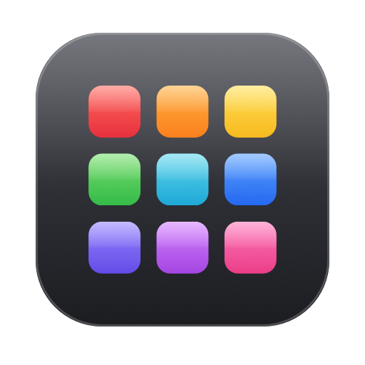

<p align="center">
  
</p>

<h1 align="center">MacBook Launchpad</h1>

<p align="center">
  <b>Bring the classic Launchpad back to macOS Tahoe.</b><br>
  A free, open-source Launchpad replacement for Mac — native SwiftUI, Liquid Glass design, under 2&nbsp;MB.
</p>

<p align="center">
  <a href="https://github.com/shivvyas2/macbook-launchpad/releases/latest"></a>
  
  
  
</p>

---

macOS 26 Tahoe removed **Launchpad** and replaced it with the Apps view. **MacBook Launchpad** brings back the full-screen grid of app icons you remember: swipe between pages, drag icons into folders, type to search, and open it from a shortcut, a hot corner, or the trackpad pinch gesture.

It is completely free, has no ads, accounts, or tracking, and the full source code is right here.

## Download

**[⬇ Download MacBook Launchpad (free DMG)](https://github.com/shivvyas2/macbook-launchpad/releases/latest)**

1. Open `MacBook-Launchpad-<version>.dmg` and drag **Launchpad** into **Applications**.
2. Open Launchpad from Applications. The first time, macOS will say it can't verify the developer — the app is open source but not notarized by Apple.
3. Go to **System Settings › Privacy & Security**, scroll down, and click **Open Anyway**. You only need to do this once.

Prefer the terminal? This does the same thing:

```sh
xattr -dr com.apple.quarantine /Applications/Launchpad.app
```

**Requirements:** macOS 26 Tahoe or later, on Apple Silicon or Intel.

## Features

- **Full-screen app grid** over your blurred wallpaper, just like the original Launchpad
- **Instant search** — start typing, press Return to open. Matches initials too (`vsc` → Visual Studio Code)
- **Folders** — drag one app onto another to group them; click the name to rename
- **Drag to rearrange**, drag to the screen edge to move between pages
- **Swipe between pages** with the trackpad, scroll wheel, or arrow keys
- **Open it your way**
  - Keyboard shortcut (default **⌥ Space**, customizable)
  - Click the Dock icon
  - Hot corner
  - Trackpad pinch with thumb and three fingers, like the original Launchpad gesture
- **Hide apps** you never launch (right-click › Hide from Launchpad)
- **Liquid Glass** search bar, folders, and controls that match macOS Tahoe
- **Remembers your layout** and picks up newly installed apps automatically
- **Open at login**, adjustable grid size and icon size
- Tiny, fast, native: written in Swift and SwiftUI, no Electron, no background services

## Keyboard shortcuts

| Key | Action |
| --- | --- |
| ⌥ Space | Show / hide Launchpad (configurable) |
| Type anything | Search apps |
| Return | Open the highlighted app |
| ← → | Previous / next page (or move the search selection) |
| Esc | Close folder, clear search, or close Launchpad |
| ⌘ , | Settings |

## Pinch gesture

macOS Tahoe uses the same pinch for its own Apps view. To use MacBook Launchpad instead, turn the system gesture off in **System Settings › Trackpad › More Gestures**. The pinch uses Apple's private MultitouchSupport framework, so it may need an update after a major macOS release; everything else keeps working regardless.

## Build from source

You need Xcode 26 (or the Swift 6.2 toolchain).

```sh
git clone https://github.com/shivvyas2/macbook-launchpad.git
cd macbook-launchpad
./build.sh --install   # builds a universal app, copies it to /Applications, and opens it
./build.sh --dmg       # builds build/MacBook-Launchpad-<version>.dmg
```

## FAQ

**Where did Launchpad go in macOS Tahoe?**
Apple removed Launchpad in macOS 26 Tahoe and replaced it with a Spotlight-based Apps list. MacBook Launchpad recreates the classic grid.

**Is it really free?**
Yes. It's MIT-licensed open source, with no in-app purchases, subscriptions, or telemetry.

**Does it need special permissions?**
No. The keyboard shortcut, hot corner, and pinch gesture all work without Accessibility or Screen Recording access.

**Where is my layout stored?**
In `~/Library/Application Support/Launchpad/layout.json`. Delete it, or use Settings › Reset Layout, to start fresh.

## Contributing

Issues and pull requests are welcome. If something looks off on your Mac, please open an issue with your macOS version and a screenshot.

## License

[MIT](LICENSE) © Shiv Vyas

<sub>Keywords: Launchpad for macOS Tahoe, Launchpad alternative, Launchpad replacement, bring back Launchpad, macOS 26 Launchpad missing, free Mac app launcher, free DMG download for Mac, open source app launcher, SwiftUI Liquid Glass.</sub>
